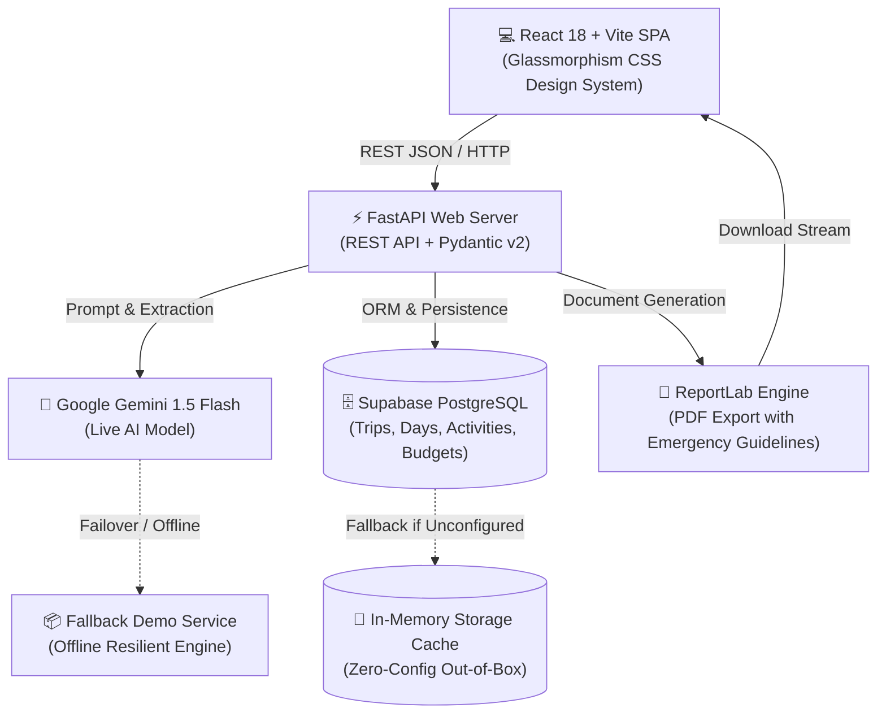

# 🌍 Personalized Travel Itinerary Planner
### AI-Powered Intelligent Travel Companion • Skill Wallet Capstone Project

[](https://fastapi.tiangolo.com)
[](https://react.dev)
[](https://www.typescriptlang.org)
[](https://vitejs.dev)
[](https://www.python.org)
[](https://opensource.org/licenses/MIT)

A modern, production-grade web application that crafts bespoke, day-by-day travel itineraries customized to user travel vibes, duration, traveler party, and itemized budgets. Powered by Google Gemini AI with resilient zero-dependency fallback for high reliability.

---

## 🏛️ System Architecture



---

## ✨ Key Features

1. **AI Recommendation Engine (Phase 8)**
   * When no destination is specified, analyzes your vibe, duration, and budget level to curate the top 3 global destinations with match justifications.
2. **Personalized Day-by-Day Itineraries (Phase 9)**
   * Curates balanced morning, afternoon, and evening activities with realistic time allocations, dining suggestions, and transit tips.
3. **Geographic Route Optimization**
   * Automatically groups nearby attractions by geographic location clusters to eliminate unnecessary commute time.
4. **Itemized Budget Estimator**
   * Categorized cost projections for Accommodation, Food & Dining, Sightseeing Activities, and Local Transit.
5. **Interactive Activity Customization & Regeneration (Phase 11)**
   * ✏️ **Inline Editing**: Tweak activity titles, time slots, locations, notes, and costs.
   * 🔄 **Single-Activity AI Replacement**: Swap out an activity for an alternative with custom instructions.
   * 🔄 **Single-Day AI Regeneration**: Re-rolls all activities for that day only, keeping other days intact.
6. **PDF Itinerary Export (Phase 12)**
   * Beautifully formatted multi-page PDF with detailed schedules, budget tables, and universal emergency contacts (112/911).
7. **Offline Demo Resilience (Phase 5)**
   * Fully functional offline or without an API key using realistic multi-vibe demo datasets.

---

## 🛠️ Technology Stack

| Component | Technology | Rationale |
|---|---|---|
| **Frontend Framework** | React 18, Vite, TypeScript | Lightning fast HMR, strict type safety, modern SPA architecture |
| **Styling & Design System** | Vanilla CSS Glassmorphism | Custom design tokens, dark navy theme, teal/gold accents, 0 runtime overhead |
| **Routing** | React Router 6 | Client-side SPA routing with nested layouts and route parameters |
| **Backend API** | Python 3.9+, FastAPI | Asynchronous high-performance REST API with automatic OpenAPI documentation |
| **Data Validation** | Pydantic v2 | Robust schema definitions and runtime request/response validation |
| **AI Integration** | Google Gemini (`google-generativeai`) | High-speed structured JSON itinerary and recommendation generation |
| **Database** | Supabase (PostgreSQL) | Relational persistence with foreign-key cascade deletions |
| **Document Export** | ReportLab | Native PDF generation with custom tables, styling, and branding |
| **Testing** | Pytest, TestClient | Automated integration test suite covering all endpoints and edge cases |

---

## 📁 Repository Structure

```
SkillWallet/
├── frontend/                  # React 18 + Vite frontend
│   ├── src/
│   │   ├── components/        # UI components (forms, itinerary, layout, trip, ui)
│   │   ├── hooks/             # Custom React hooks (useTrips, useTrip)
│   │   ├── layouts/           # AppLayout with Navbar and ToastProvider
│   │   ├── pages/             # DashboardPage, PlanTripPage, ItineraryPage
│   │   ├── services/          # Axios API service clients
│   │   ├── types/             # TypeScript interfaces and models
│   │   ├── utils/             # Formatters and currency helpers
│   │   ├── App.tsx            # Route definitions
│   │   └── index.css          # Design system & glassmorphism theme
│   ├── package.json
│   └── vercel.json            # Vercel SPA rewrite configuration
├── backend/                   # FastAPI backend
│   ├── app/
│   │   ├── api/               # API routers (trips, itinerary, recommendations, export)
│   │   ├── core/              # Settings, logging, and security
│   │   ├── database/          # Supabase client & in-memory operations
│   │   ├── schemas/           # Pydantic request/response schemas
│   │   ├── services/          # Gemini AI, demo engine, and PDF export services
│   │   └── main.py            # FastAPI application entry point
│   ├── tests/                 # Comprehensive Pytest suite
│   ├── Procfile               # Container and PaaS web entrypoint
│   └── requirements.txt       # Python dependencies
├── supabase/
│   └── migrations/            # SQL migration scripts
├── docs/
│   ├── DEPLOYMENT_GUIDE.md    # Production deployment instructions
│   ├── PROJECT_PROGRESS.md    # Milestone activity tracking
│   └── ACTIVITY_LOG.md        # Chronological development log
├── render.yaml                # Infrastructure as Code (IaC) blueprint
├── MASTER_PLAN.md             # Complete 15-phase implementation plan
└── README.md                  # Project overview (this document)
```

---

## 🚀 Quickstart Guide

### Prerequisites
* **Node.js** v18+ & npm
* **Python** 3.9+ & pip
* *(Optional)* Google Gemini API Key & Supabase project

### 1. Run Backend Server

```bash
cd backend

# Create and activate virtual environment
python3 -m venv venv
source venv/bin/activate       # On Windows: venv\Scripts\activate

# Install dependencies
pip install -r requirements.txt

# Start backend server
uvicorn app.main:app --reload --port 8000
```
> The API will be live at `http://localhost:8000`  
> Interactive Swagger UI documentation: `http://localhost:8000/docs`

### 2. Run Frontend Client

```bash
cd frontend

# Install dependencies
npm install

# Start Vite dev server
npm run dev
```
> Open your browser at `http://localhost:5173`

---

## 🧪 Testing & Quality Assurance

The codebase includes an integration and unit test suite verifying all happy paths, edge cases, 404 handlers, validation errors, and PDF exports.

```bash
# Run backend test suite (12 tests)
cd backend
./venv/bin/pytest -v

# Run frontend production build test
cd frontend
npm run build
```

---

## 🌐 Deployment Configuration

This repository includes deployment configurations for both single-click and split deployments:

* **Render Blueprint ([`render.yaml`](./render.yaml))**: Automatically provisions both the FastAPI web service and the React static site.
* **Vercel Config ([`frontend/vercel.json`](./frontend/vercel.json))**: Handles client-side routing rewrites for SPA page refreshes.
* **Container Entrypoint ([`backend/Procfile`](./backend/Procfile))**: Standard web process definition for PaaS environments.

For step-by-step production deployment instructions, refer to [`docs/DEPLOYMENT_GUIDE.md`](./docs/DEPLOYMENT_GUIDE.md).

---

## 📡 REST API Reference

| Method | Endpoint | Description |
|---|---|---|
| `GET` | `/health` | Server health check, AI status, and DB connectivity |
| `GET` | `/api/v1/trips` | List all saved travel trips |
| `POST` | `/api/v1/trips` | Create a new trip record |
| `GET` | `/api/v1/trips/{id}` | Retrieve complete trip with days and activities |
| `PUT` | `/api/v1/trips/{id}` | Update trip title, duration, or preferences |
| `DELETE` | `/api/v1/trips/{id}` | Delete trip and cascade delete activities |
| `POST` | `/api/v1/recommendations` | Get top 3 AI destination recommendations |
| `POST` | `/api/v1/itinerary/generate` | Generate full multi-day itinerary with budget |
| `POST` | `/api/v1/itinerary/{id}/day/{num}/regenerate` | Regenerate activities for a single day |
| `POST` | `/api/v1/itinerary/{id}/activity/replace` | Replace single activity slot with AI alternative |
| `PUT` | `/api/v1/itinerary/{id}/activity` | Update individual activity fields inline |
| `GET` | `/api/v1/export/{id}/pdf` | Export complete trip itinerary as styled PDF |

---

## 📜 Capstone Submission Checklist

- [x] **Milestone 1**: Vibe Coding Environment Setup & Architecture
- [x] **Milestone 2**: Database Schema Design & Supabase Migration
- [x] **Milestone 3**: Backend Core APIs & Preference Collection
- [x] **Milestone 4**: Gemini AI Prompt Engineering, Generation & Day/Activity Regeneration
- [x] **Milestone 5**: PDF Itinerary Export & Integration Testing
- [x] **Milestone 6**: Production Deployment Configuration (`render.yaml`, `vercel.json`)
- [x] **Milestone 7**: Complete Documentation, Clean Commits & Master Plan Verification

---

## 📄 License

This project is licensed under the MIT License — see the [LICENSE](./LICENSE) file for details.

*Built with ❤️ for the Skill Wallet Capstone Project.*
